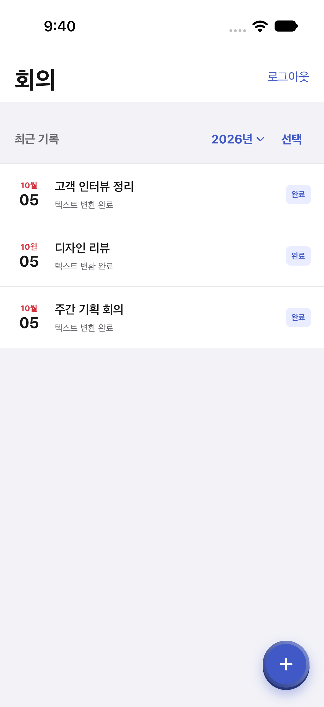
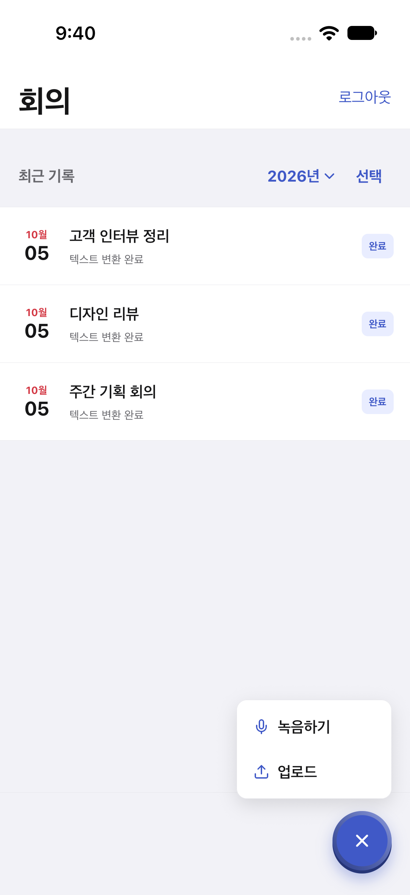
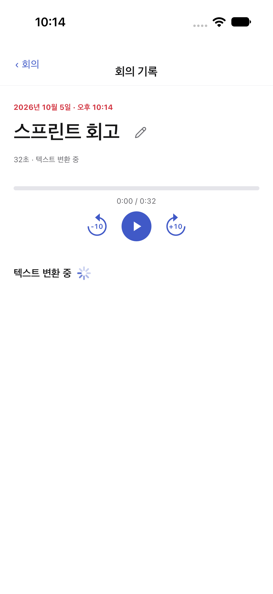
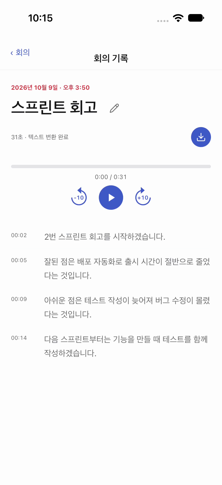
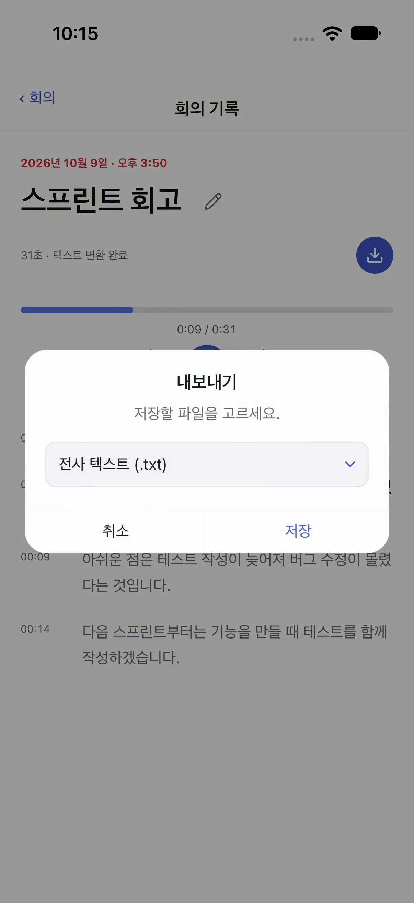
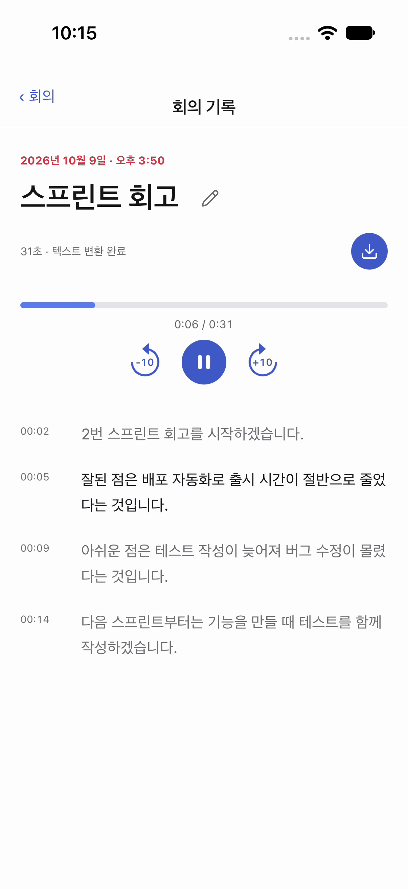

# EchoNote

EchoNote는 회의를 녹음하고 그 녹음을 개인 PC(Windows, NVIDIA GPU)에서 텍스트로 바꿔(전사, transcription) 문장 단위로 다시 들을 수 있게 해 주는 회의 기록 앱입니다.

상용 회의 전사 서비스는 대부분 유료이거나 무료 사용량에 제한이 있어서 사용량 걱정 없이 쓸 수 있도록 직접 만들었습니다. iPhone과 Android 어느 기기에서든 같은 앱으로 쓰고 PC가 꺼져 있어도 녹음과 재생은 계속되는 것을 목표로 했고 React Native와 백엔드 기초를 실제 서비스를 만들며 익히려는 목적도 있었습니다.

그 결과 녹음은 기기에 남기고, 전사는 개인 PC가 맡고, 클라우드는 계정·작업 상태·잠근 전사문만 보관하는 앱이 되었습니다. 기획부터 검증까지 AI 코딩 도구와 함께 진행한 개인 프로젝트이며, 방향 결정과 설계 승인, 실기기 검증은 직접 판단했습니다. 지원용 요약은 [PORTFOLIO.md](./PORTFOLIO.md)에 있습니다.

## 목차

- [설계 원칙](#설계-원칙)
- [시연](#시연)
- [주요 기능](#주요-기능)
- [기술 스택](#기술-스택)
- [구조 한눈에](#구조-한눈에)
- [검증](#검증)
- [실행 방법](#실행-방법)
- [트러블슈팅](#트러블슈팅)
- [알려진 제한](#알려진-제한)
- [데이터 위치와 보호](#데이터-위치와-보호)
- [상용화를 위해 고려 중인 것](#상용화를-위해-고려-중인-것)
- [더 보기](#더-보기)
- [포트폴리오 요약](./PORTFOLIO.md)

## 설계 원칙

- **녹음 파일을 클라우드에 두지 않습니다.** 회의 음성은 민감한 개인 데이터라서 Vercel이나 Supabase 같은 외부 서비스에 저장하지 않습니다.
  앱은 개인 네트워크(Tailscale)를 통해 파일을 개인 PC로 직접 전송하고 서버(Gateway)는 "이 작업을 처리해도 된다"는 허가만 중계합니다.
- **전사문은 서버가 잠가 저장합니다.** Supabase에 저장하는 전사문은 봉투 암호화(envelope encryption, 결과마다 다른 데이터 열쇠(DEK)로 내용을 잠그고 그 데이터 열쇠를 다시 열쇠용 열쇠(KEK)로 잠그는 방식)로 잠가 둡니다. KEK는 Gateway 실행 환경에만 있고 Supabase·코드 저장소(git)·앱·Worker에는 두지 않습니다.
- **카드 등록이 필요한 도구를 쓰지 않습니다.** Vercel Hobby, Supabase Free, Tailscale의 무료 등급만으로 운영하며 무료 한도 안에서 동작하도록 설계를 맞췄습니다.
- **PC가 꺼져 있어도 기본 기능은 됩니다.** 녹음, 재생, 목록 조회, 삭제는 기기 안의 SQLite와 파일 영역만으로 동작하고 전사처럼 PC의 GPU가 필요한 작업만 PC가 켜져 있을 때 가능합니다.
- **iOS와 Android를 같은 코드로 만듭니다.** 화면과 로직은 Expo React Native 한 벌로 작성하고 두 플랫폼에서 실제 기기로 검증합니다.

## 시연

영상: [시연 영상 (v0.1.0 Release)](https://github.com/Pangho04/EchoNote/releases/tag/v0.1.0)

| 목록                                    | 녹음·업로드 선택                                           | 전사 진행                                            | 전사 결과                                          |
| --------------------------------------- | ---------------------------------------------------------- | ---------------------------------------------------- | -------------------------------------------------- |
|  |  |  |  |

| 파일 내보내기                                      | 문장 탭 재생                                        |
| -------------------------------------------------- | --------------------------------------------------- |
|  |  |

## 주요 기능

- **백그라운드 녹음** — 앱을 나가거나 화면을 꺼도 녹음이 계속되고 iOS·Android 모두 백그라운드 녹음을 지원합니다.
- **녹음과 파일 업로드** — 앱에서 바로 녹음을 시작하거나, 기기에 있는 m4a 파일을 업로드해 같은 흐름으로 전사할 수 있습니다.
- **전사 요청과 진행 상태 표시** — 회의 상세 화면에서 전사를 요청하면 진행 상태가 표시되고 실패하면 이유를 보여주며 다시 요청할 수 있습니다.
- **PC가 꺼져 있을 때 안내** — 전사를 요청하기 전에 PC가 켜져 있는지 확인하고 꺼져 있으면 "데스크탑에 연결할 수 없습니다" 안내와 함께 PC를 켜거나 Tailscale 연결을 확인하라고 안내합니다.
- **문장 탭 재생** — 전사 결과는 문장 단위로 나뉘어 표시되고 문장을 누르면 그 문장이 시작하는 위치로 재생이 이동합니다.
- **회의 파일 저장** — 회의 상세에서 녹음(m4a)이나 전사(txt)를 고르면 OS 저장 화면이 열리고 원하는 위치에 저장할 수 있습니다.
- **회의 이름 바꾸기, 연도 필터, 일괄 삭제** — 회의 이름을 바꾸거나, 연도별로 목록을 좁히거나, 여러 회의를 한 번에 선택해 지울 수 있습니다.
- **로그인** — Supabase Auth로 로그인하며 세션은 iOS Keychain·Android Keystore에 저장됩니다.

## 기술 스택

| 영역          | 기술                                                   | 선택 이유                                                                                                                                                                                                                                                         |
| ------------- | ------------------------------------------------------ | ----------------------------------------------------------------------------------------------------------------------------------------------------------------------------------------------------------------------------------------------------------------- |
| 모바일        | Expo 57, React Native 0.86, Expo Router 57, TypeScript | iOS·Android를 한 React Native 앱으로 만들고 백그라운드 녹음을 지원하기 위해 골랐습니다. Expo Web 산출물로 Electron 화면을 공유하는 구조이며, 데스크탑 앱은 현재 보류 중입니다.                                                                                    |
| 서버(Gateway) | Fastify 5, Node.js, TypeScript, Vercel 배포            | 작은 API에 타입·검증·테스트를 갖추면서 서버를 직접 익히려고 골랐습니다. 로컬과 Vercel 배포가 같은 앱을 쓰고, Vercel이 Fastify를 별도 설정 없이 인식합니다.                                                                                                        |
| DB·인증       | Supabase(PostgreSQL, Auth, RLS)                        | PostgreSQL과 사용자 인증을 카드 등록 없는 무료 등급에서 함께 쓸 수 있고, 상태 변경과 결과 저장을 Postgres 함수(RPC) 하나의 transaction으로 묶을 수 있습니다.                                                                                                      |
| 파일 전송     | Tailscale Serve(HTTPS)                                 | Windows 업로드 API를 인터넷에 공개하지 않기 위해 썼습니다. Vercel은 요청 본문이 4.5MB로 제한돼 있어 녹음 파일을 Gateway로 보낼 수도 없습니다.                                                                                                                     |
| 전사 노드     | TypeScript 상시 프로세스 + Docker(faster-whisper, GPU) | `large-v3`로 한 번 더 전사하는 보조 경로와 비교했지만 얻는 이득이 작아 `large-v3-turbo` 하나만 씁니다. Docker는 Engine API SDK 대신 CLI를 `execFile`로 호출해 Windows named pipe 설정과 새 의존성을 피합니다.                                                     |
| 공유 계약     | Zod 기반 TypeScript 패키지(`packages/contracts`)       | 앱·Gateway·Worker가 같은 스키마를 공유하고, 실행 중에 데이터를 검증합니다.                                                                                                                                                                                        |
| 테스트·검증   | Vitest, Jest, Maestro(실기기 E2E), pgTAP               | Vitest는 Node에서 도는 함수·통합 테스트를, Jest(jest-expo)는 RN 컴포넌트 테스트를 맡습니다. Maestro는 Detox보다 설정이 거의 필요 없고 Appium처럼 대기 코드를 직접 짜지 않아도 되며, pgTAP은 DB 규칙(RLS·권한·제약)을 역할을 바꿔 가며 rollback 안에서 검증합니다. |
| 도구          | Python(STT 품질 비교 벤치마크)                         | 모델 품질 실험용 도구이며 제품 런타임에는 쓰지 않습니다.                                                                                                                                                                                                          |

## 구조 한눈에

```text
[iPhone·Android 앱] --(작업 생성·상태 확인)--> [Vercel Gateway] <----> [Supabase: Auth·DB]
        |                                            ^
        | (녹음 파일은 Tailscale로 PC에 직접 전송)      | (결과 전달 → Gateway가 잠가 저장)
        v                                            |
[개인 PC(Windows): Worker + Whisper] ------------------
```

앱은 Gateway에 "이 회의를 전사해도 되는지" 작업 생성과 상태 확인만 요청합니다. 녹음 파일 자체는 Gateway를 거치지 않고 Tailscale을 통해 개인 PC로 직접 전송됩니다.

자세한 흐름과 저장 위치, 실패 시 동작은 [docs/ARCHITECTURE.md](./docs/ARCHITECTURE.md)에 적습니다.

## 검증

| 항목                                            | 값                                                                                 | 확인하는 것                                                               |
| ----------------------------------------------- | ---------------------------------------------------------------------------------- | ------------------------------------------------------------------------- |
| `pnpm verify`(lint·format·typecheck·test·build) | 통과                                                                               | 코드 스타일과 타입, 각 패키지 빌드가 깨지지 않았는지                      |
| 자동 테스트                                     | 1,458건(mobile 806, inference-worker 311, ai-gateway 248, contracts 91, desktop 2) | 단위·통합 단위에서 로직이 명세대로 동작하는지                             |
| 실기기 E2E(Maestro, flow 11개)                  | Android 실기기 11/11, iPhone 실기기 11/11(maestro-runner)                          | 실제 기기에서 녹음부터 목록·상세 화면까지 사용자 흐름이 끝까지 동작하는지 |

flow 목록과 실행법은 `apps/mobile/e2e/maestro/README.md`에 있습니다.

## 실행 방법

요구 환경:

- Node.js 최신 LTS, pnpm
- iOS 개발: Xcode, CocoaPods, iPhone 실기기
- Android 개발: Android Studio, USB 디버깅을 켠 Android 실기기
- 추론: Windows, Docker Desktop, NVIDIA GPU, Tailscale
- 배포: 카드 등록 없는 Vercel Hobby, Supabase Free

```bash
nvm install
corepack enable
pnpm install
pnpm verify
```

주요 명령:

```bash
pnpm dev:mobile:ios   # iPhone 개발 빌드 설치
pnpm dev:mobile:aos   # Android 개발 빌드 설치
pnpm dev:mobile       # 양쪽 설치 뒤 Metro 실행
pnpm dev:desktop      # Electron (보류 상태)
pnpm dev:gateway      # 로컬 Gateway 실행
pnpm dev:worker       # 추론 Worker
```

저장소 구조:

```text
apps/
  mobile/     iOS·Android·Web 공통 Expo 앱
  desktop/    Electron 메인·preload(보류 상태)
packages/
  contracts/  클라이언트·Gateway·Worker 공유 Zod 계약
services/
  ai-gateway/        Vercel에 배포하는 Fastify 제어 API
  inference-worker/  Windows에서 실행하는 추론 제어 프로세스
tools/
  stt-benchmark/  음성 인식 품질·후보 비교 실험 도구
```

## 트러블슈팅

개발과 실기기 검증 중 원인을 끝까지 추적해 해결한 문제입니다.

### 1. Vercel 배포가 세 단계에서 연달아 막힘

- **문제** — Gateway를 Vercel에 배포하자 빌드 타입 오류(TS2339), 함수 500(`Invalid export found in module src/server.js`), 요청 무응답이 차례로 나타났습니다.
- **원인** — 세 문제 모두 Vercel의 Fastify 빌더가 동작하는 방식에서 비롯됐습니다.
  - 빌더의 타입 검사는 symlink를 따라가지 않아 pnpm 격리 배치에서 `undici-types`를 찾지 못했고 그 결과 전역 `Response`가 빈 타입이 됐습니다.
  - 빌더는 fastify를 import하는 파일을 진입점으로 고르는데, `src/index.ts`가 fastify를 직접 import하지 않아 서버 생성 파일이 대신 선택됐습니다.
  - Vercel은 `listen`을 가로채 완료 콜백을 부르지 않으므로, `await server.listen(...)`이 끝나지 않아 모듈 로드가 멈췄습니다.
- **해결** — `undici-types`를 Gateway devDependency로 직접 추가하고 `src/index.ts`에 `import 'fastify';`를 넣어 진입점을 고정했으며 `listen`은 await하지 않고 실패만 처리하도록 바꿨습니다.

### 2. iOS 녹음에서 목소리가 떨리고 길이가 실제와 다름

- **문제** — 녹음 파일의 목소리가 떨렸고 파일 길이도 실제 녹음 시간과 달랐습니다.
- **원인** — 파형을 분석하자 70–80 ms마다 완전 무음 구간이 끼어 있었습니다. 오디오 엔진을 출력 경로에 연결한 채 녹음하면 엔진이 출력 속도에 맞춰 입력을 당기다가, 입력이 모자란 순간을 0으로 채운 것으로 판단했습니다.
- **해결** — 출력 경로에 연결하지 않고 입력 노드에서 소리를 바로 받도록 구조를 바꿨고 이후 녹음에서는 무음 구간이 사라졌습니다.

### 3. iOS 27 기기에서 앱이 실행 즉시 종료

- **문제** — Xcode 27로 빌드한 개발 앱이 iOS 27 기기에서 실행하자마자 종료(signal 5)됐습니다.
- **원인** — Xcode 27은 iOS 27 SDK만 제공하고, 그 SDK로 빌드한 앱은 UIKit의 scene 생명주기(앱 전체가 아니라 창 단위로 시작·중단을 관리하는 방식)를 요구합니다. Expo SDK 57 기본값은 예전 application 생명주기(앱 전체를 하나로 관리하는 방식)였습니다.
- **해결** — `app.config.js`의 `expo-build-properties` 플러그인에 `ios.enableSceneSupport: true`를 두고 네이티브 앱을 다시 빌드했습니다.

### 4. Android 녹음 품질 개선

- **문제** — 같은 합성 음성을 틀고 기기 기본 녹음 앱과 비교하자 iPhone은 차이가 없었지만, Android는 1 m에서 전사 오류율(CER)이 회마다 23–100 %로 들쭉날쭉했습니다(기본 앱 15–31 %). 3 m에서는 99–100 %였습니다.
- **원인** — 녹음 입력을 통화용(`VOICE_COMMUNICATION`)으로 열고 있었습니다. 이 모드는 통화 상대 목소리만 남기도록 말 없는 구간과 작은 말소리를 완전 무음(0)으로 지웁니다. 파형에서 10 ms 단위 무음 비율이 1 m 47–70 %, 3 m 95–98 %였고, 기본 앱과 iPhone은 0.1 % 이하였습니다.
- **해결** — 입력 소스별로 음량을 맞춰 녹음·전사를 비교한 뒤 일반 마이크(`MIC`)로 바꾸고, 원시 입력이 21 dB 작아진 만큼 증폭을 +11 dB에서 +37 dB로 올렸습니다. 1 m 전사 오류율(CER)이 15.9 %로 내려갔습니다. 3 m는 기기 마이크 경로의 감도 차이로 기본 앱에 못 미치며 이번 범위 밖으로 두었습니다.

### 5. Android 업로드에서 삼성 음성 녹음 파일을 고를 수 없음

- **문제** — 업로드 파일 선택 화면에서 삼성 「음성 녹음」 앱이 만든 `.m4a` 파일이 선택되지 않았습니다.
- **원인** — 파일 머리의 형식 표지가 `ftyp3gp4`로, 확장자와 달리 휴대폰용 MP4 형식인 3GP였습니다. Android 파일 선택기는 이 파일을 `audio/mpeg`로 분류했고, 앱은 선택기에 `audio/mp4`·`audio/x-m4a`만 요청하고 있어 파일이 걸러졌습니다. 그 뒤 단계인 앱의 헤더 검사와 Worker 업로드 검사는 `ftyp` 표지만 확인하므로 원래 통과하는 파일이었습니다.
- **해결** — Android에서만 선택기 요청 형식에 `audio/mpeg`·`audio/3gpp`를 더했습니다. `ftyp` 표지가 없는 진짜 MP3 등은 기존 헤더 검사가 막습니다. Android 기기에서 삼성 녹음 파일을 골라 업로드와 전사가 완료되는 것을 확인했습니다.

### 6. Android 「다운로드」에서 고른 파일의 회의 이름이 `msf:숫자`로 나옴

- **문제** — 업로드한 파일 이름을 회의 이름으로 쓰는데, 선택 창의 「다운로드」 메뉴로 고르면 `msf:1000002358` 같은 값이 나왔습니다. 같은 파일을 「내부 저장소」 메뉴로 고르면 정상이었습니다.
- **원인** — 앱이 파일 주소의 마지막 칸을 이름으로 썼습니다. Android 원본 소스(AOSP)를 보니 두 메뉴는 주소를 만드는 시스템 프로그램이 달랐습니다. 「내부 저장소」는 주소에 경로를 넣어 끝에 파일 이름이 남지만, 「다운로드」는 파일 목록 DB의 행 번호(`msf:` + 번호)만 넣습니다. Android는 이 주소를 해석하지 말고 이름은 `DISPLAY_NAME`으로 따로 물으라고 정하고 있었습니다.
- **해결** — `DISPLAY_NAME`을 조회해 주는 `expo-document-picker`로 파일 선택을 바꿨습니다. 기존 `expo-file-system`에는 이 값을 JS로 꺼내는 기능이 없었습니다. Android·iPhone E2E 업로드 flow가 통과했고, Android 기기의 「다운로드」 메뉴에서 고른 파일 이름이 회의 이름으로 나오는 것을 확인했습니다.

## 알려진 제한

- 업로드·전사는 개인 Tailscale 네트워크 전용이라 외부인은 체험할 수 없습니다.
- iOS는 유료 개발자 계정 없이 개인 개발 빌드로만 설치합니다.
- Electron 데스크탑 앱은 보류 상태입니다.
- 회의 날짜는 녹음이 실제로 일어난 시각이 아니라 앱에 등록한 시각(`createdAt`)입니다.

## 데이터 위치와 보호

| 데이터              | 어디에                                         | 어떤 형태로                                 | 누가 읽을 수 있나                                                                |
| ------------------- | ---------------------------------------------- | ------------------------------------------- | -------------------------------------------------------------------------------- |
| 녹음 원본           | 기기 로컬 파일 영역, 개인 PC(Tailscale로 전송) | 원본 파일                                   | 기기 소유자, PC 운영자                                                           |
| 전사문              | Supabase `transcripts` + 앱 SQLite 사본        | Supabase엔 봉투 암호화 암호문, 앱엔 평문    | 회의 소유자(Gateway를 거쳐서만), 운영자(KEK 보유). Supabase 단독 접근은 암호문만 |
| 작업 상태·오류 코드 | Supabase `jobs`                                | 평문(상태·오류 코드·크기·해시만, 본문 없음) | Gateway, 운영자(Supabase 콘솔)                                                   |
| 로그인 세션         | iOS Keychain·Android Keystore                  | 토큰                                        | 기기 소유자                                                                      |
| 내보낸 파일         | 사용자가 OS 저장 화면에서 고른 위치            | 평문 사본(m4a·txt)                          | 저장 위치에 접근할 수 있는 누구나. EchoNote가 보호하거나 지울 수 없음            |
| 서버 로그           | Vercel·Supabase 로그                           | 전사·녹음 본문과 열쇠는 남기지 않음         | 운영자                                                                           |

Supabase 프로젝트는 `ap-south-1`(인도 뭄바이) 리전에 있고 Vercel 함수는 미국 기본 리전에서 실행됩니다. 전사문의 암호화·복호화와 KEK는 미국 리전 Vercel 함수에서 다룹니다. 국외 보관 고지·처리방침과 서울 리전 이전 계획은 [docs/BACKLOG.md](./docs/BACKLOG.md) 3번에 적었습니다.

## 상용화를 위해 고려 중인 것

현재 공개 범위는 위에 적은 구현까지입니다. 여러 사용자가 쓰는 서비스로 키우려면 아래가 더 필요하다고 보고 [docs/BACKLOG.md](./docs/BACKLOG.md)에 설계 방향을 적어 두었습니다.

- **계정 기반 복원** — 회의 목록·전사문을 서버 원본으로 옮기고, 녹음은 개인 PC를 보관소로 삼아 새 기기에서도 로그인만으로 목록·전사문·음성이 돌아오게 합니다. 클라우드에 음성을 두지 않고 무료 한도 안에서 하는 방향입니다. (BACKLOG 10번)
- **개인정보 처리방침·앱 안내·서버 자동 삭제** — 국외 보관 고지, 첫 전사 요청 때 안내, 앱이 내려받은 전사문을 서버에서 지체 없이 지우는 흐름입니다. 현재 형태(판매·사업자 신고 없음)에서는 법정 보관 의무가 없어 보유 기간을 스스로 정하고, 유료화하면 다시 확인합니다. (BACKLOG 3번)
- **전사문 열쇠용 열쇠(KEK) 회전** — 열쇠가 새었을 때 전사문을 다시 잠그지 않고 열쇠만 바꾸는 절차입니다. (BACKLOG 9번)

## 더 보기

프로젝트 진행 중 내린 설계 결정과 근거는 [docs/DECISIONS.md](./docs/DECISIONS.md), 전체 구조와 전사 요청 경로는 [docs/ARCHITECTURE.md](./docs/ARCHITECTURE.md)에 적습니다.
